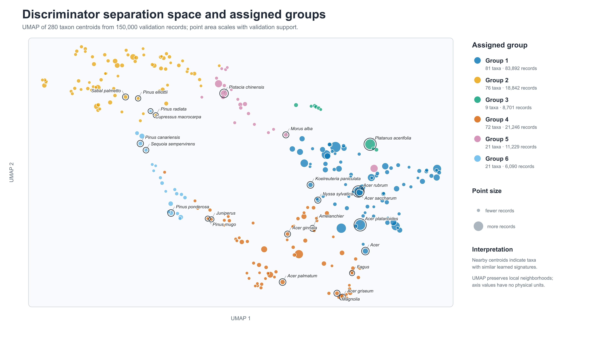
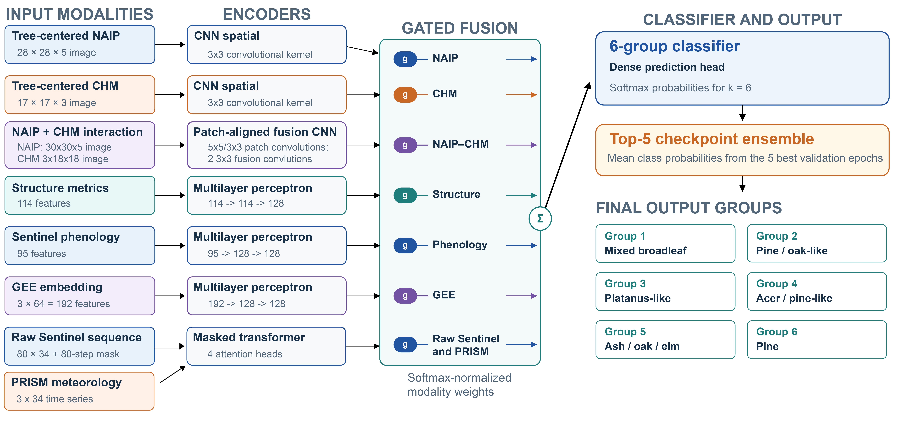

# Manuscript model pipeline

This directory contains the two modeling stages used for the manuscript. The
checked-in partition and collapse configuration are frozen artifacts selected
without using the independent test set.

## Directory layout

- [`discriminator/`](discriminator/) contains stage-one discriminator
  training, validation-only group construction, rare-taxon assignment, and
  independent evaluation. Its [README](discriminator/README.md) is the
  authoritative stage-one workflow.
- [`stage2/`](stage2/) contains the fixed-partition classifier, checkpoint
  ensemble evaluation, and final configuration. Its
  [README](stage2/README.md) is the authoritative stage-two workflow.
- [`model_components.py`](model_components.py) contains shared PyTorch
  encoders and runtime helpers used by both stages.
- [`script_manifest.csv`](script_manifest.csv) classifies every public model
  entry point as final, exploratory, evaluative, or supporting code.
- [`tests/`](tests/) contains lightweight encoder smoke tests.

Generated checkpoints, embeddings, prediction exports, and input shards are
not stored in Git.

The complete model-input shard dataset is available from
[Google Drive](https://drive.google.com/file/d/1w_dBZZpTgRVNfBL0-zrhhU7tJkKSsjJM/view?usp=sharing).

The final discriminator model bundle is available from
[Google Drive](https://drive.google.com/file/d/1yDKvUhOKYt_-wgEWzVxq-gO6Azwr9rrj/view?usp=sharing).

The final pruned stage-two model bundle, including the five checkpoints used
for the reported ensemble, is available from
[Google Drive](https://drive.google.com/file/d/1HoV5XiQSYIoHN0NanS3hPHoOTnQjWzU-/view?usp=sharing).

## Final workflow

1. Train the discriminator using
   [`discriminator/final_discriminator_config.json`](discriminator/final_discriminator_config.json).
   Group construction uses exported validation embeddings only.
2. Select and freeze the 11 intermediate groups (`k11`) from the core taxa,
   which have at least 500 records.
3. Pass taxa with 50–499 records through the frozen discriminator and assign
   each taxon from a development-only centroid. Held-out records do not define
   their own labels.
4. Freeze the validation-selected `k11` partition and the mapping from `k11`
   to the six reported groups (`collapsed_k6`).
5. Evaluate the frozen discriminator grouping on the independent test split.
6. Train the stage-two classifier to predict `k11`, selecting checkpoints and
   stopping epochs with validation data only.
7. Average the `k11` class probabilities from the five highest-scoring
   validation checkpoints. Only after ensembling, sum probabilities according
   to the frozen mapping and select the `collapsed_k6` prediction.
8. Evaluate the final ensemble and retained sensitivity analyses on the
   independent test split.

The six reported groups are therefore not predictions from a separately
trained six-class network. Probability-sum collapse occurs after the
checkpoint ensemble.

## Frozen grouping artifacts

- [`../config/final_k11_partition.npz`](../config/final_k11_partition.npz):
  taxon-to-`k11` assignment used by the stage-two model.
- [`../config/final_k11_to_k6_collapse.npz`](../config/final_k11_to_k6_collapse.npz):
  numerical `k11`-to-`collapsed_k6` probability-sum mapping.
- [`../config/final_grouping.json`](../config/final_grouping.json):
  human-readable mapping, provenance, and artifact checksums.

Group identifiers are zero-based in NPZ arrays and one-based in manuscript
displays.

## Portable execution

Set `DATA_ROOT` to the local directory containing the model-input shards,
prepared memory-mapped arrays, and frozen split manifest. Stage-specific
commands and required arguments are documented in the two linked READMEs.
Machine-specific paths should be supplied at runtime and are not embedded in
the tracked model configuration.

The final raster branches use GroupNorm, as frozen in the two stage-specific
configuration files. BatchNorm remains implemented only for historical model
compatibility and controlled comparisons. Run the shared-component checks with
`python -m unittest model.tests.test_model_components` from the repository
root.

The scripts in [`../analysis/`](../analysis/) reproduce the retained ablation,
geographic-transfer, sensitivity, and figure analyses. Development-only
benchmarks and smoke tests are intentionally omitted from this public
manuscript snapshot.
